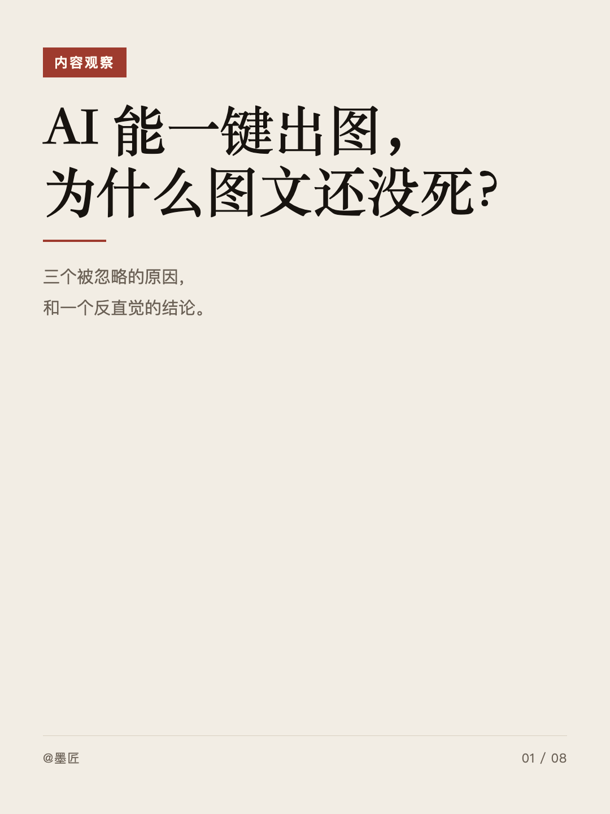
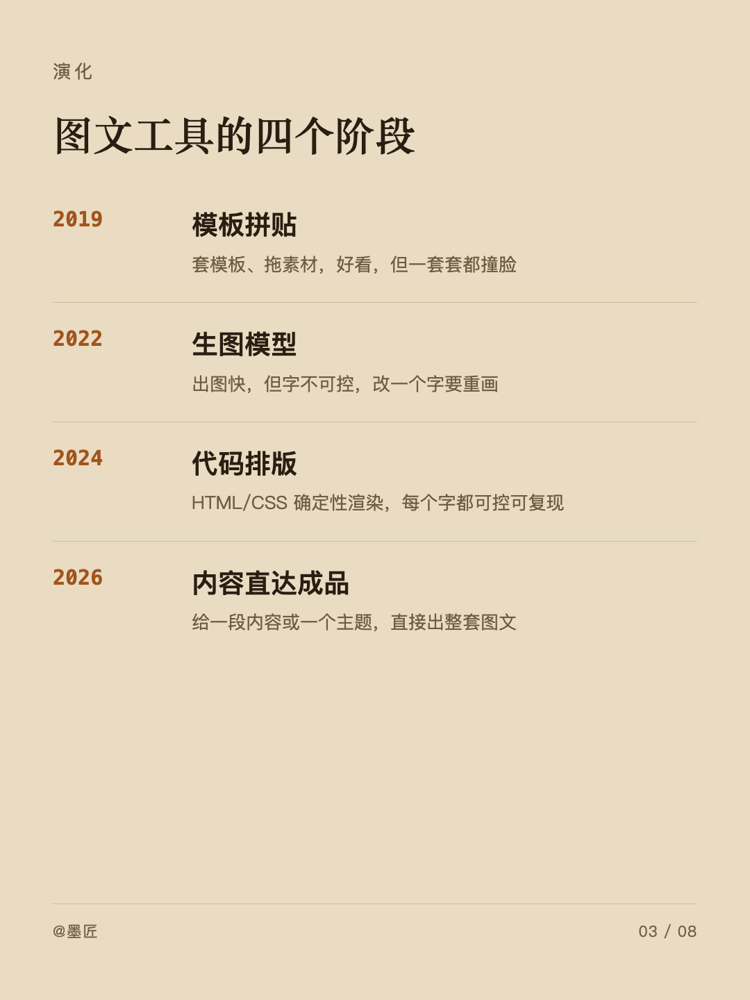
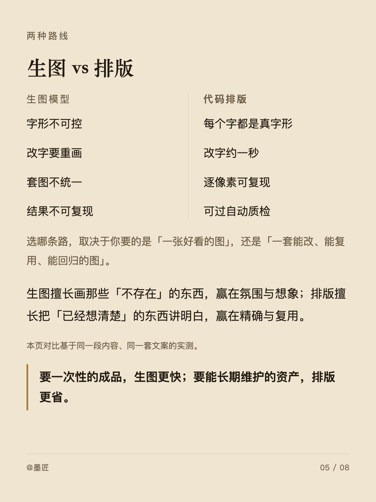
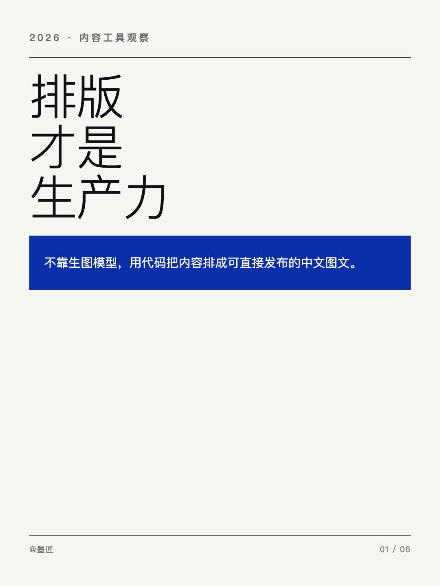
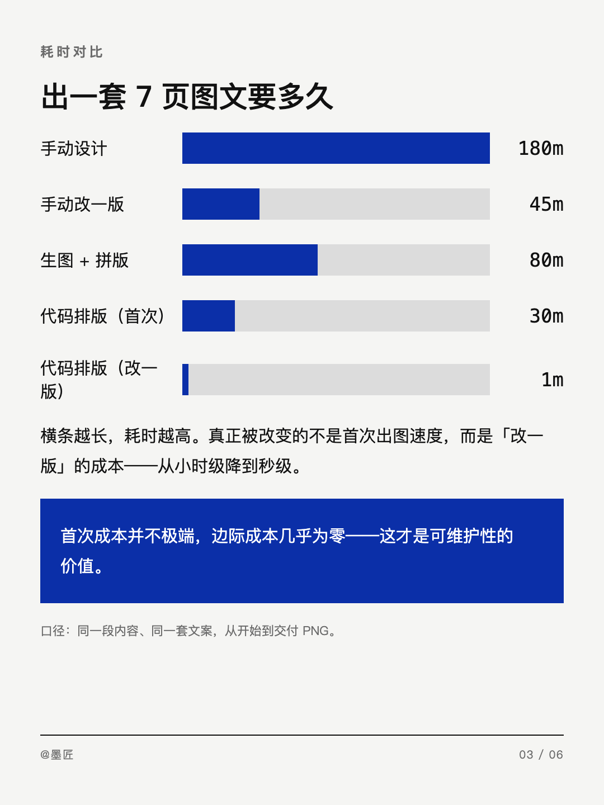
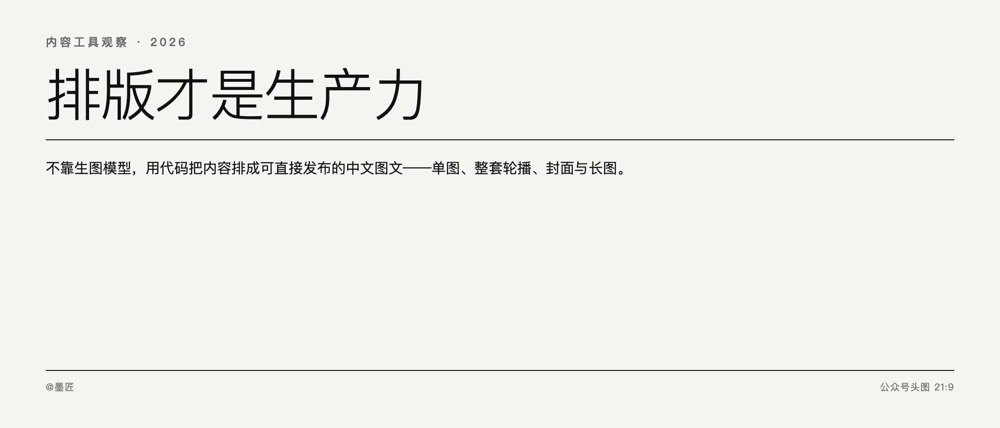

# Tuwen Forge · 墨匠

不用生图模型，用代码把内容、故事或主题排成**可直接发布的中文图文**：单图、整套轮播、公众号封面对、中文长图。

## 类型

Agent 型（单个 AI 专家）。花名 **墨匠**，职业 **图文排版师**，类目 `06-ContentCreative`。

## 效果

下面全部是**种子模板真实渲染出来的 PNG**（`skills/tuwen-engine/assets/gallery/`），不是设计稿、不是生图，是 HTML/CSS 过 Playwright 出来的。

**Editorial 编辑杂志风**（`ink` 墨纸经典 / `kraft` 牛皮纸 / `dune` 沙丘）

| 封面 `M01` | 时间线 `M09` | 对比页 `M08` |
|---|---|---|
|  |  |  |

**Swiss 瑞士国际主义**（`klein` 克莱因蓝 / `amber` 琥珀橙）

| 封面 `S01` | H-Bar 图 `S10` | 公众号头图 21:9 |
|---|---|---|
|  |  |  |

> 注意 21:9 头图：标题与正文都在**中心 1:1 区域内**，被朋友圈/会话列表按中心裁切后仍然完整。


## 为什么做成 Agent 型

「把内容做成图」是一个**路由问题**，不是分工问题：判断该不该做、做哪种出口、走哪套风格、挑哪个版式骨架——这些决策必须在同一个上下文里连续做，拆给多个角色反而会丢失上下文。

排版、内容策划、摄影构图这些"专业领域知识"**不需要各自一个角色**，需要的是**一份能被随时查阅的规则库**。所以它们做成了四个内置技能，而不是四个团队成员。

## 内置技能（4 个）

| 技能 | 提供什么 | 运行时 |
|---|---|---|
| `tuwen-engine` | **入口编排**：四个决定（做不做 / 做哪种 / 做几页 / 怎么验）+ 出口决策 + 风格与主题路由 + 28 个版式骨架 + 三套可渲染种子模板 + `render.cjs` / `verify.cjs` | Node（Playwright）+ 系统 Chrome |
| `tuwen-typography` | **中文排版与版式美学**：CJK 字体栈与字宽估算、标点与避头尾、中英混排、字号阶梯与「越大越细」、网格与留白、配色与对比度、视觉层级与扫读动线 | 纯知识库 |
| `tuwen-storytelling` | **内容策划与叙事**：封面钩子、拆页方法（一页一个判断）、叙事节奏（导演视角）、文案压缩六法、事实核验与不编造 | 纯知识库 |
| `tuwen-imagery` | **图像与摄影构图**：取图优先级与图源协议、三分法与主体判断、文字压图与 quiet-zone 避让、截图美化、后期插图路线 | 纯知识库 |

## 比"直接写个 prompt"多了什么

1. **出口决策**。同一份内容发小红书、发公众号、做成长图，尺寸与页数预算完全不同。本包定死了四条出口路径与对应画板尺寸。
2. **风格与主题系统**。两套视觉系统（Editorial 编辑杂志风 / Swiss 瑞士国际主义）× 10 套主题预设。**不允许自定义 hex**——保护美学稳定性比给自由更重要。
3. **28 个版式骨架**。Editorial 16 个（`M01`–`M16`）+ Swiss 12 个（`S01`–`S12`），每个都带文案上限与最小密度。
4. **三套真正能渲染的种子模板**。不是描述，是可直接拷贝、改文案、立刻出图的 HTML。
5. **确定性渲染 + 机械质检**。`render.cjs` 走 Playwright 出 PNG；`verify.cjs` 用**真实 DOM 测量**跑 8 条规则（溢出 / 页脚碰撞 / 字号下限 / 横带密度 / 标题行数 / 标题间距 / 底部空洞 / **末行孤字**）。有 error 不得交付。第 8 条（孤字）是中文排版里「肉眼才看得出」的典型瑕疵，本包用 `Range.getClientRects()` 把它自动化了。
6. **专业领域知识落成规则**。不是"要好看一点"，而是"正文不小于 24px""相邻字号档差 ≥ 1.35 倍""越大越细""中英之间留 1/4 空隙""21:9 头图的中心 1:1 必须独立成立"。
7. **诚实的渲染边界**。哪些能跑、哪些只是参考、跑不动怎么办，写清楚了。

## 实测过的环境结论

| 结论 | 证据 |
|---|---|
| **系统 Chrome + `--no-sandbox` 可以截图** | 1080×1440 @1x 出图 50–120 KB，中文清晰无缺字 |
| **Playwright 自带 chromium 不可用** | 本机缓存 `chromium_headless_shell-1148`，`playwright-core` 期望 `1243` → `Executable doesn't exist`。**必须优先走系统 Chrome** |
| **ESM `import` 不认 `NODE_PATH`** | 报 `ERR_MODULE_NOT_FOUND`。渲染脚本一律写成 `.cjs` 并用绝对路径 `require` |
| **Playwright 在托管 node 工作区里可用** | `~/.workbuddy-ai/binaries/node/workspace/node_modules/playwright-core` |
| **三套种子模板全部 0 error / 0 warn** | Editorial 8 张、Swiss 8 张（含 21:9 + 1:1 封面对）、长图 1 张（1080×4020），8 条规则下复测通过 |
| **R8 孤字检测确实能抓到人工漏项** | 只有前 7 条规则时，Editorial 模板 `08-cta` 的末行孤字被漏过；补上 R8 后立刻测出，加 `text-wrap:pretty` 后归零 |
| **R7 区域级判据确实比整页判据严** | 造反例（`.allow-void` 在顶部固定高度、底部留 63% 空洞）：整页判据静默放过（2 warn），区域级判据报出 R7（3 warn）。三套模板 + 演示稿回归后仍全部 0 error / 0 warn，无误报 |
| **长图不会被渲染视口截断** | 视口 2200×1600，实测 `.poster.long` 6412 px @1x（视口 4 倍）、12824 px @2x 完整出图。元素截图取元素盒子，与视口高度无关 |
| **长图两端留白与规范一致** | `.poster.long` 垂直 `padding:120px`，实测首内容元素距顶 **120 px**、末元素距底 **120 px**，与 `platform-specs.md` 的 120 px 要求吻合 |
| **默认 `--scale 1` 即为平台原生尺寸** | 1080×1440 就是小红书的目标文件尺寸；2x 只增加体积 |

## 快速开始

```bash
# 1. 拷一套种子模板当任务文件
mkdir -p tuwen/my-topic
cp skills/tuwen-engine/assets/template-swiss.html tuwen/my-topic/index.html

# 2. 改 data-theme、改文案（保持 class 不变）

# 3. 渲染
node skills/tuwen-engine/scripts/render.cjs tuwen/my-topic

# 4. 过闸门
node skills/tuwen-engine/scripts/verify.cjs tuwen/my-topic
```

若 `node` 找不到 playwright，设置：

```bash
PLAYWRIGHT_PATH=~/.workbuddy-ai/binaries/node/workspace/node_modules \
  node skills/tuwen-engine/scripts/render.cjs tuwen/my-topic
```

## 使用示例

- 把这篇内容做成一套小红书图文，风格你帮我挑，5 张左右
- 只有一个主题：AI 时代为什么还要学排版，帮我做整套图文
- 把这篇文章做成公众号封面对：21:9 头图 + 1:1 分享卡
- 把这份季度复盘做成一张中文长图信息图
- 这段内容太长了，帮我压到 7 页以内
- 这套图太丑了，换个风格重做一版

## 目录结构

```
tuwen-forge/
├── .codebuddy-plugin/plugin.json
├── manifest.yaml
├── agents/tuwen-forge.md
├── avatars/tuwen-forge.jpg
├── README.md · LICENSE
└── skills/
    ├── tuwen-engine/
    │   ├── SKILL.md
    │   ├── references/{platform-specs,style-system,theme-presets,layout-recipes,qa-checklist,render-pipeline}.md
    │   ├── assets/{template-editorial,template-swiss,template-longform}.html
    │   └── scripts/{render,verify}.cjs
    ├── tuwen-typography/{SKILL.md, references/×5}
    ├── tuwen-storytelling/{SKILL.md, references/×5}
    └── tuwen-imagery/{SKILL.md, references/×5}
```

## 交付规范

交付**两样东西**：渲染好的 PNG，以及一段交付说明（出口 / 视觉系统 / 主题 / 每页版式 / 质检结论 / 被砍掉的内容）。

**先给图，再给说明。** 不要把制作术语写进图里。

## 首期边界

- ✅ 做：中文图文排版（单图 / 整套轮播 / 公众号封面对 / 长图），4 种画板尺寸，2 套视觉系统，10 套主题，28 个版式骨架
- ⏳ 后期：矢量插图库、故事型模板、朋友圈 / 知乎问答模板、图表组件化、动态卡
- ❌ 不做：生图模型出图、竖排、横向翻页 PPT

## 许可

本包自身新增部分采用 **MIT**。第三方借鉴的合规边界见 [`LICENSE`](./LICENSE)。
